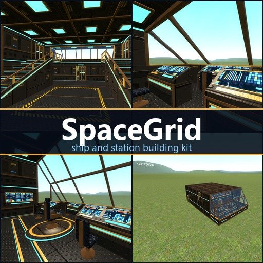
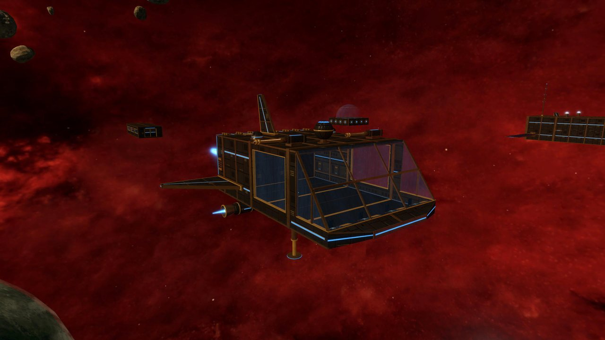
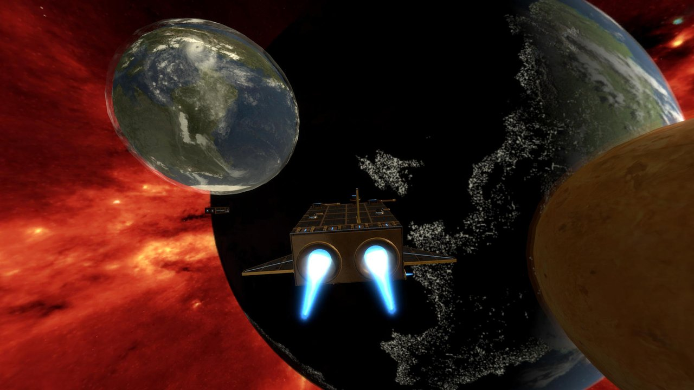
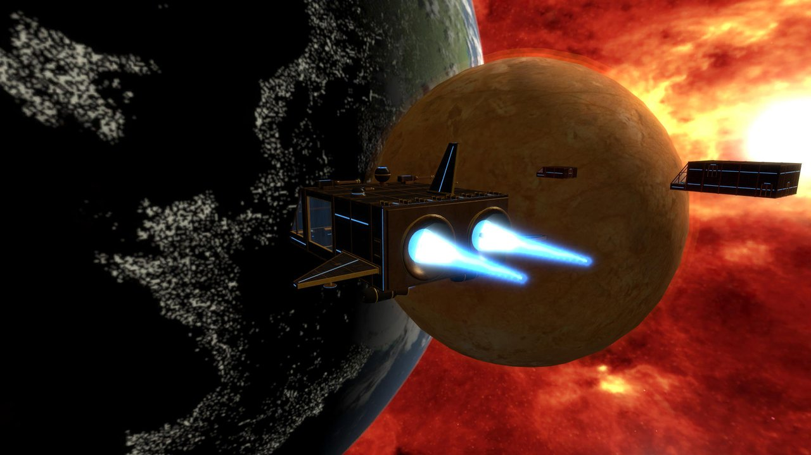
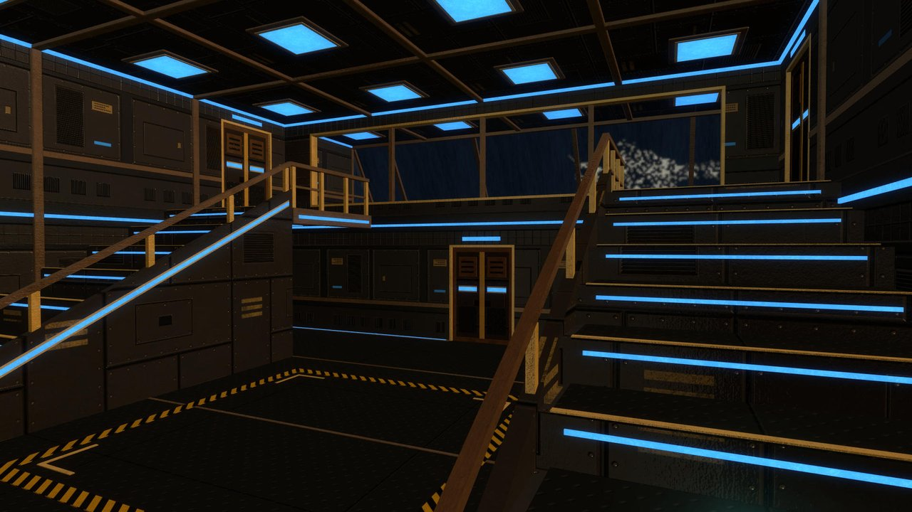
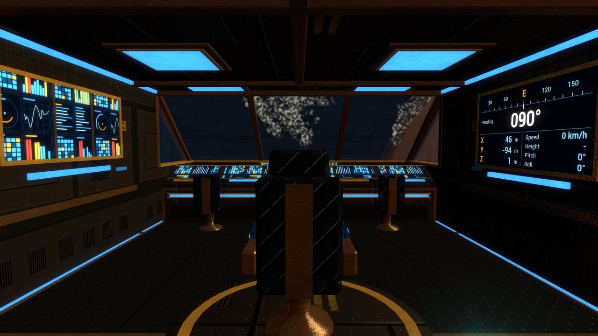
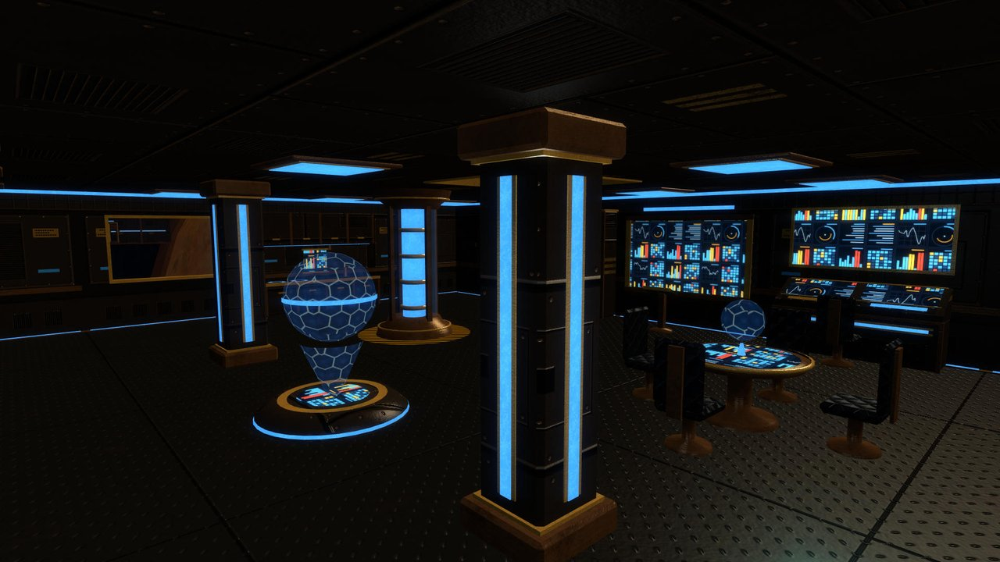
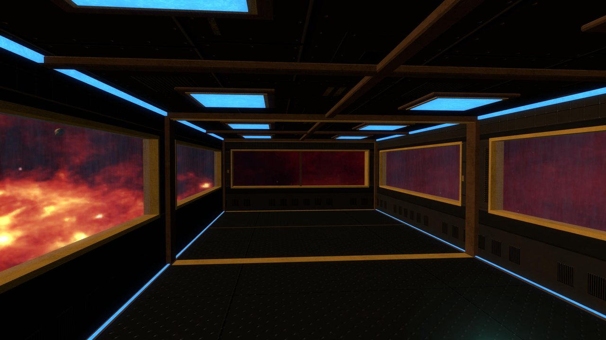
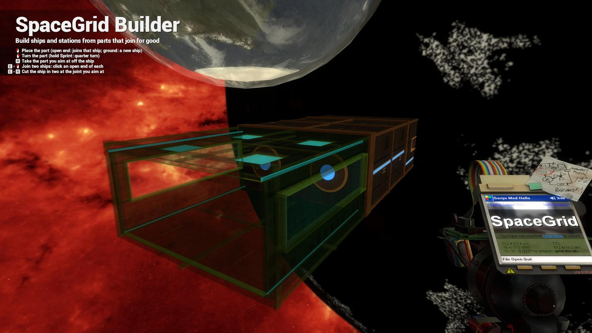

# SpaceGrid - Ship and Station Building Kit

> Snap parts together. Get one ship, not a pile of welded props.

SpaceGrid is a building kit for spaceships and stations. Corridors, halls, hangars, rooms, bridges, engines - they snap together with one tool and become one solid ship. A big ship stays calm when you unfreeze it, pastes in one go with the duplicator and is one physics body instead of hundreds of welded props.

## Install
**Steam Workshop (easiest):** subscribe [there](https://steamcommunity.com/sharedfiles/filedetails/?id=3840679187).

**By hand:** download `spacegrid-0.1.0.zip` from [Releases](../../releases/latest) and unpack it into
`garrysmod/addons/` (you get the folder `garrysmod/addons/spacegrid`).

## Bugs, problems and wishes
Please use [Issues](../../issues): pick *Bug report* or *Wish or idea*. On the Steam Workshop page the comments work too.

## Pictures

---

## What's inside

### About 250 parts
- Five sizes of space: corridors (S, M), halls (L), hangars (XL) and great halls (XXL), plus small crawl ways
- Windows and glass domes, doors, airlocks and gates
- Cockpits and bridges, complete and furnished rooms, a lift and a ladder shaft
- Engines, thrusters, wings, landing gear, antennas, lamps

### Building that makes sense
- Every open end closes itself with a wall: whatever you build is airtight from the start
- Join a part there and the wall goes away. A doorway, airlock or gate is your way in
- Want a hangar mouth? R on the wall opens that end for good, R on the opening closes it again
- Join two ships into one, or cut one in two at a joint (hold E + R)

### On board
- Doors open by themselves; chairs, gate panels, lamps, light switches, lifts and landing legs work with E
- Ladder shafts: look up or down and walk forward to climb
- Closed rooms hold air for PowerGrid's life support, and you don't drown in a closed ship under water
- Navigation console with compass, heading, position, speed and height

### Flying (with StarCore)
A ship with a cockpit, bridge or control desk gets its StarCore core by itself the moment you sit down at the helm. F switches to a camera behind the ship, the mouse wheel moves it; Ctrl stays "down". Get up and the ship stays parked where it hovers. Engines and thrusters glow while it moves, landing legs fold in by themselves.

### Wiremod
Doors, gates, force fields, lamps, lights and the lift take Wire inputs; the navigation console gives position, speed, heading and more.

---

## Required
Nothing - you can build without anything else. These add to it:
- **PowerGrid**: air in closed rooms
- **StarCore**: flying
- [Wiremod](https://steamcommunity.com/sharedfiles/filedetails/?id=160250458): Wire inputs and outputs

All Ascension Gates addons in one click: [Ascension Gates - Complete](https://steamcommunity.com/sharedfiles/filedetails/?id=3840681489)

## First steps
1. Open the spawn menu tab **SpaceGrid** and pick a part - you get the SpaceGrid Builder with it.
2. Left click the ground: your ship starts there.
3. Left click an open end of the ship: the next part snaps on. Right click turns it to the next opening.
4. R on a part takes it off again. Undo works per part.

All texts in English, Czech, German, Spanish, Estonian, French, Croatian, Hungarian, Dutch, Russian, Swedish and Turkish; SpaceGrid follows the game's language.

## Early version
This is version 0.1. It builds, flies and holds air, and a lot more is planned: more parts, more rooms, more ways to join them. Tell me what you want to build and what's missing.

## Privacy
SpaceGrid collects nothing and never goes online.

---

## Build fund
> Every part in this kit was made from scratch. So was a lot of coffee.

If SpaceGrid built you something you're proud of, a small tip funds the next set of parts:

Telling me in the comments what you built makes my day too.

---

## Licence
MIT (licence text on [GitHub](https://github.com/moonrise420/spacegrid)). All models and textures are made by SpaceGrid's own generator; the sounds are Garry's Mod's own.
